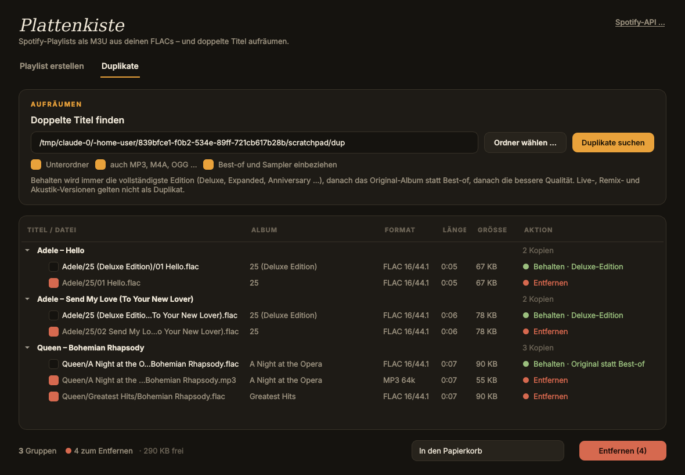

# Plattenkiste

Eigenständiges Programm für Windows und macOS, ohne Installation:

- **Playlist erstellen:** Spotify-Playlist-Link + Ordner mit FLAC-Dateien → M3U-Playlist mit denselben Songs
- **Duplikate:** doppelte Titel im Musikordner finden und aufräumen
- **Tags:** ausgewählten Songs gemeinsam ein Genre, eine Gruppierung oder eine Stimmung geben


## Download

Unter [**Releases**](https://github.com/iamSoules/Plattenkiste/releases/latest) die passende Datei herunterladen.
Plattenkiste wird nicht installiert, und Python brauchst du auch nicht. Alles steckt im Programm.

| System | Datei | So startest du sie |
|---|---|---|
| Windows | `…-windows-portable.exe` | **eine einzelne Datei**, einfach doppelklicken. Beim ersten Start richtet sie sich kurz selbst ein. |
| Windows | `…-windows.zip` | **Ordner-Version**: entpacken und `Plattenkiste.exe` im Ordner starten (z. B. vom USB-Stick) |
| macOS Apple Silicon (M1 und neuer) | `…-macos-apple-silicon.zip` | entpacken und `Plattenkiste.app` starten |
| macOS Intel | `…-macos-intel.zip` | entpacken und `Plattenkiste.app` starten |

- **macOS:** Die App ist nicht von Apple beglaubigt. Öffne sie beim ersten Mal deshalb so:
  Systemeinstellungen → Datenschutz & Sicherheit → „Dennoch öffnen“.
- **Windows:** Bei der SmartScreen-Warnung „Weitere Informationen“ → „Trotzdem ausführen“.

## Reiter „Playlist erstellen“

1. Spotify-Link einfügen → **Laden** (Playlist muss öffentlich sein; Album-Links gehen auch)
2. **Ordner wählen** – die Tags (Titel, Interpret, Länge, ISRC) aller FLACs werden gelesen
3. Der Abgleich startet automatisch. Grün = sicher, Gelb = bitte prüfen, Rot = fehlt
4. Doppelklick auf eine Zeile → anderen Vorschlag oder eine Datei von Hand zuordnen
5. **M3U speichern**

### Hinweise
- Ohne Zugangsdaten liest die App die öffentliche Spotify-Einbettungsseite – das liefert max. **100 Titel**.
  Für größere Playlists: unter developer.spotify.com eine App anlegen und Client-ID/Secret
  über „Spotify-API …“ eintragen (dann wird auch per ISRC abgeglichen).
- Alternativ: Playlist mit exportify.net als CSV exportieren und „oder CSV importieren“ nutzen.
- Dateien ohne Tags werden über den Dateinamen erkannt (`Interpret - Titel.flac`).
- „relative Pfade“ ist ideal, wenn die M3U im Musikordner liegt (z. B. für Player auf anderen Geräten).

## Reiter „Duplikate“



Findet doppelte Titel in deinem Musikordner, auch über verschiedene Editionen hinweg
(z. B. „25“ und „25 (Deluxe Edition)“).

**Welche Datei bleibt?** Der Reihe nach:
1. die vollständigste Edition: Super Deluxe > Deluxe / Expanded / Anniversary > Bonus / Limited / Remaster > normal
2. das Original-Album statt Best-of / Greatest Hits / Sampler
3. die bessere Qualität (FLAC vor MP3, 24 Bit vor 16 Bit, höhere Samplerate/Bitrate)

**Kein Duplikat** sind Live-, Remix-, Akustik- oder Extended-Versionen. Auch derselbe Titel mit deutlich anderer
Länge (> 6 Sekunden) zählt nicht.

Vor dem Entfernen kannst du jede Datei per Häkchen ab- oder anwählen. Entfernt wird nie endgültig:
- **In den Papierkorb** (Standard), oder
- **in den Ordner `_Duplikate`** im Musikordner (die Ordnerstruktur bleibt erhalten, der Ordner wird beim Scannen ignoriert).

Ordner, die danach leer sind, werden mit entfernt.

## Reiter „Tags“

Gibt ausgewählten Songs einen gemeinsamen Tag (Genre, Gruppierung oder Stimmung). Auf Geräten ohne
M3U-Unterstützung lassen sich die Songs dann z. B. über **Genres** wie eine Playlist abspielen.

- **Auswählen:** aus einer Playlist der Queue, aus einer vorhandenen M3U oder von Hand (Suche, Haken, Mehrfachauswahl)
- **Hinzufügen / Ersetzen / Entfernen** eines Werts, mit **Rückgängig** für die letzte Änderung
- **„in einem Feld“** speichert mehrere Werte als `Rock; Roadtrip` für Player, die nur den ersten Genre-Eintrag lesen
- Die Seitenleiste zeigt alle vorhandenen Werte mit Anzahl. Ein Klick filtert die Liste.

## Projektaufbau

```
src/                  App (app.py = Oberfläche, core.py = Spotify & Abgleich, dupes.py, tagger.py)
assets/icon.ico       Windows-Icon
docs/                 Screenshots
packaging/windows/    EXE-Launcher (C#) + build.py
packaging/macos/      build.sh → Plattenkiste.app
.github/workflows/    baut bei jedem Push beide Pakete
```

## Neues Release veröffentlichen

1. Die neue Versionsnummer in die Datei `VERSION` schreiben, z. B. `1.2.0`.
2. Committen mit `[release]` in der Nachricht und pushen:

```bash
git commit -am "Version 1.2.0 [release]"
git push
```

GitHub Actions baut dann die Windows- und macOS-Programme und legt das Release `v1.2.0` mit allen Downloads an.
Ein gepushter Tag `v1.2.0` oder der Button „Run workflow“ unter **Actions** (mit Haken bei „release“) geht genauso.

Die Programme lassen sich auch selbst bauen: `python packaging/windows/build.py` (auf jedem System, braucht das .NET SDK)
bzw. `packaging/macos/build.sh` (nur auf dem Mac). Details stehen in [`packaging/windows/README.md`](packaging/windows/README.md).
