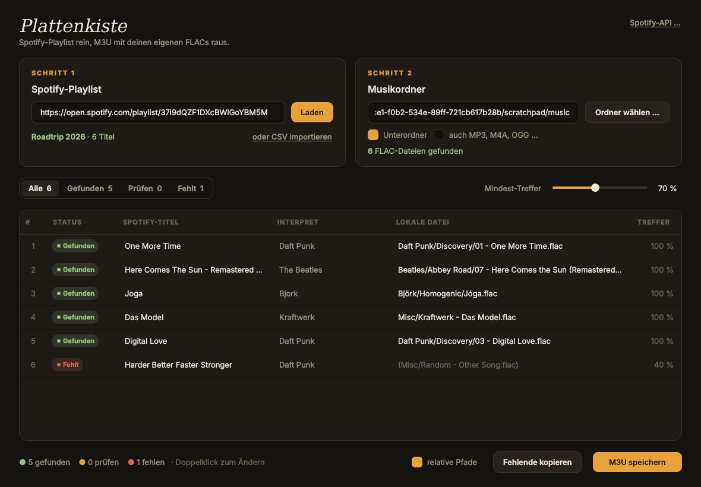

# Plattenkiste

Spotify-Playlist-Link + Ordner mit FLAC-Dateien → M3U-Playlist mit denselben Songs.

## Starten
- **Windows:** `start.bat` doppelklicken (braucht Python 3.10+ von python.org)
- **macOS/Linux:** `./start.sh`

Beim ersten Start wird automatisch eine virtuelle Umgebung mit den Abhängigkeiten angelegt.

## So geht's
1. Spotify-Link einfügen → **Laden** (Playlist muss öffentlich sein; Album-Links gehen auch)
2. **Ordner wählen** – die Tags (Titel, Interpret, Länge, ISRC) aller FLACs werden gelesen
3. Der Abgleich startet automatisch. Grün = sicher, Gelb = bitte prüfen, Rot = fehlt
4. Doppelklick auf eine Zeile → anderen Vorschlag oder eine Datei von Hand zuordnen
5. **M3U speichern**

## Hinweise
- Ohne Zugangsdaten liest die App die öffentliche Spotify-Einbettungsseite – das liefert max. **100 Titel**.
  Für größere Playlists: unter developer.spotify.com eine App anlegen und Client-ID/Secret
  über „Spotify-API …“ eintragen (dann wird auch per ISRC abgeglichen).
- Alternativ: Playlist mit exportify.net als CSV exportieren und „oder CSV importieren“ nutzen.
- Dateien ohne Tags werden über den Dateinamen erkannt (`Interpret - Titel.flac`).
- „relative Pfade“ ist ideal, wenn die M3U im Musikordner liegt (z. B. für Player auf anderen Geräten).

## Reiter „Duplikate“

Findet doppelte Titel in deinem Musikordner, auch über verschiedene Editionen hinweg
(z. B. „25“ und „25 (Deluxe Edition)“).

**Welche Datei bleibt?** Der Reihe nach:
1. die vollständigste Edition: Super Deluxe > Deluxe / Expanded / Anniversary > Bonus / Limited / Remaster > normal
2. das Original-Album statt Best-of / Greatest Hits / Sampler
3. die bessere Qualität (FLAC vor MP3, 24 Bit vor 16 Bit, höhere Samplerate/Bitrate)

**Kein Duplikat** sind Live-, Remix-, Akustik- oder Extended-Versionen. Auch derselbe Titel mit deutlich anderer
Länge (> 6 Sekunden) zählt nicht.

Vor dem Entfernen kannst du jede Datei per Häkchen ab- oder anwählen. Entfernt wird nie endgültig:
- **In den Papierkorb** (Standard), oder
- **in den Ordner `_Duplikate`** im Musikordner (die Ordnerstruktur bleibt erhalten, der Ordner wird beim Scannen ignoriert).

Ordner, die danach leer sind, werden mit entfernt.

## Reiter „Tags“

Gibt ausgewählten Songs einen gemeinsamen Tag (Genre, Gruppierung oder Stimmung). Auf Geräten ohne
M3U-Unterstützung lassen sich die Songs dann z. B. über **Genres** wie eine Playlist abspielen.

- **Auswählen:** aus einer Playlist der Queue, aus einer vorhandenen M3U oder von Hand (Suche, Haken, Mehrfachauswahl)
- **Hinzufügen / Ersetzen / Entfernen** eines Werts, mit **Rückgängig** für die letzte Änderung
- **„in einem Feld“** speichert mehrere Werte als `Rock; Roadtrip` für Player, die nur den ersten Genre-Eintrag lesen
- Die Seitenleiste zeigt alle vorhandenen Werte mit Anzahl. Ein Klick filtert die Liste.

## Windows-Pakete

Die Launcher-Quellen und die Bauanleitung liegen in [`packaging/`](packaging/README.md).
